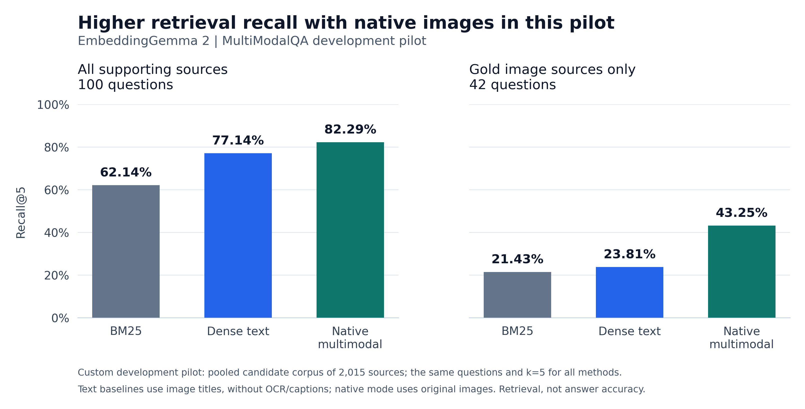

# MultiModalQA retrieval experiment

This experiment compares lexical retrieval, text embeddings, and native image
embeddings on the same fixed pilot. It evaluates supporting-source retrieval;
answer quality requires a separate generation evaluation.

## Fixed inputs

- 100 development questions, sampled with seed 42.
- 2,015 sources: 997 passages, 98 tables serialized as text, and 920 original images.
- The corpus is the union of all supplied candidate contexts for these questions,
  including distractors. Every question searches that entire union.
- 42 questions require image evidence; 58 do not. Forty-six questions have one
  labelled source, 53 have two, and one has seven.
- Model: `google/embeddinggemma-2`, revision
  `914f7f89142e33e77833254d9c9b90c3cef7303b`; float32, NVIDIA GeForce RTX 4060
  Laptop GPU, PyTorch 2.12.1+cu130. Dense-text used batch size 4; native mode used
  batch size 8 after 164 images had been encoded at batch size 4. The first 136
  dense-text vectors were reused from an earlier CPU run at the same precision.
- All methods return at most five sources. The seven-source question cannot reach
  complete support at this cutoff, regardless of ranking quality.

Corpus fingerprint:
`2ac934df42e9fbb82ba4abeb7576470af2735daba665642046db0d397a90dd4f`.

Question fingerprint:
`e4c8eb70fd4d3d5143426d55dfd367a193d560d59459a9d0b48d0fcad66d2016`.

## Compared inputs

BM25 and dense-text search passages, serialized tables, and image-title metadata.
They do not use OCR or image captions. Native multimodal retrieval embeds the
original images and uses the same passage/table text as the text methods. Native
image inputs do not include image titles. This comparison therefore measures the
implemented evidence representations; it does not isolate a visual-model effect
while holding all image metadata constant.

The same normalized cosine search is used for both embedding methods. No gold
support labels, reference answers, or intermediate answers are passed to the
encoders. Dataset annotations retain those values separately for scoring.

## Completed results

All three methods scored all 100 questions against all 2,015 sources. Corpus and
question fingerprints match exactly across the saved reports.

| Method | Recall@5 | Hit@5 | MRR@5 | nDCG@5 | All-support@5 |
|---|---:|---:|---:|---:|---:|
| BM25 | 0.6214 | 0.7500 | 0.6165 | 0.5667 | 0.5000 |
| EmbeddingGemma 2 dense text | 0.7714 | 0.9100 | 0.8195 | 0.7411 | 0.6400 |
| EmbeddingGemma 2 native multimodal | **0.8229** | **0.9400** | 0.8160 | **0.7627** | **0.7100** |

Native multimodal retrieval improved Recall@5 by **5.14 percentage points** over
dense text and **20.14 points** over BM25. It recovered every labelled source for
71 questions, compared with 64 for dense text and 50 for BM25. Dense text retained
a small MRR advantage; native retrieval was not better on every metric.

A paired question bootstrap gives an exploratory 95% percentile interval of
**+0.14 to +10.50 percentage points** for native-minus-dense Recall@5 (10,000
resamples, seed 42; the same question IDs are paired in each resample). The lower
bound is close to zero. Question resampling also ignores dependencies between
questions that share sources. Treat the observed +5.14-point gain as a pilot
finding to validate on a separate test set, not a general performance guarantee.

## Where the difference comes from

| Question group | Questions | BM25 Recall@5 | Dense-text Recall@5 | Native Recall@5 |
|---|---:|---:|---:|---:|
| Image evidence required | 42 | 0.3724 | 0.5034 | **0.6378** |
| No image evidence required | 58 | 0.8017 | **0.9655** | 0.9569 |

The table above scores all required sources for each question. A question that
needs both a table and an image can earn partial recall by retrieving only its
table. To measure image retrieval itself, the following diagnostic keeps the
original top-five results and scores only the labelled image sources, averaging
per question across the 42 questions with gold images:

| Method | Image-support Recall@5 | At least one gold image in top five |
|---|---:|---:|
| BM25 | 0.2143 | 0.2143 |
| Dense text | 0.2381 | 0.2381 |
| Native multimodal | **0.4325** | **0.4524** |

Native image-support recall increased by **19.44 percentage points** over the
title-based dense baseline. This is direct evidence that original image inputs
helped retrieve visual evidence in this pilot. It is not evidence of better
generated answers, which this experiment did not evaluate.

Two source-retrieval examples illustrate the gains and remaining errors:

- For the question about an album poster with a gorilla, native retrieval found
  the labelled image in its top five; dense text found no labelled source.
  Question ID: `mmqa:299e684293fffb0f9dca76a1092c83f9`.
- For the question about Manuel Lazzari's piercing, dense text found the labelled
  image using its available metadata; native retrieval missed it. Question ID:
  `mmqa:08e66ea55258dfb1e76421a0cd580108`. This supports testing a future fusion of
  titles and visual embeddings rather than discarding either representation.

Machine-readable reports: [BM25](../results/mmqa-comparison/bm25.json),
[dense text](../results/mmqa-comparison/dense-text.json),
[native multimodal](../results/mmqa-comparison/multimodal.json), and
[subgroups and changed questions](../results/mmqa-comparison/analysis.json).
The [comparison table](../results/mmqa-comparison/comparison.md) is generated only
after checking matching corpus, question and cutoff signatures.

## Figure for reports and slides



Download the [300 dpi PNG](../results/mmqa-comparison/retrieval-comparison.png) or
the [editable vector SVG](../results/mmqa-comparison/retrieval-comparison.svg).
The chart shows measured means on a shared 0–100% scale, without confidence bars.
Regenerate it from the saved reports with:

```powershell
.venv\Scripts\python.exe scripts/plot_results.py
```

The plotting script checks matching corpus, question and cutoff fingerprints,
then calculates image-source recall directly from saved rankings and gold IDs.
It does not load models or rerun retrieval. Its only optional dependency is
Matplotlib.

## Reproduction and timing

Run or resume with:

```powershell
$env:HF_HUB_OFFLINE = '1'
$env:TRANSFORMERS_OFFLINE = '1'
$env:OMP_NUM_THREADS = '8'
$env:MKL_NUM_THREADS = '8'
.venv\Scripts\python.exe run.py compare --dataset data/prepared/mmqa --methods bm25 dense-text multimodal --device cuda --batch-size 4 --output results/mmqa-comparison
```

The command reuses compatible completed caches. A fresh run can use a different
batch size to fit available memory; batch size affects throughput and small
floating-point differences, not the source representation or evaluation scope.
Use `--device cpu` when CUDA is unavailable.

Document embeddings are checkpointed after each batch, so an interrupted index
build reuses completed batches. The cache signature covers source content, media
content hashes, model revision, precision, and processing settings. Completed
whole-index caches remain supported.

Recorded mean search times were 1.87 ms for BM25, 489.55 ms for dense text, and
155.28 ms for native multimodal. These runs were sequential on a shared machine
and are **not controlled hardware speed comparisons**. Index-build values in the
JSON reports (165.16 seconds dense text; 332.96 seconds native) measure resumed
runs, excluding earlier checkpointed work; they are not cold-build timings.

This is a custom development pilot, not the published full MultiModalQA benchmark
or a held-out test result. Do not compare these numbers directly with leaderboard
scores. Runtime figures describe a shared local machine.
