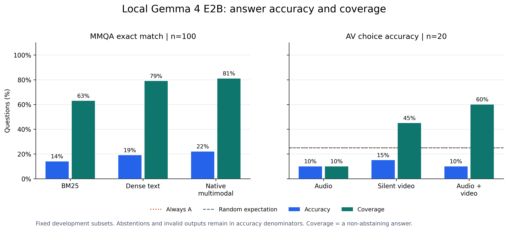

# ProjectMemory: local multimodal retrieval and grounded question answering

Technical report, 15 October 2026. The assessment report and presentation follow
the supplied word limit and rubric; they are submitted separately and are not
part of this repository.

## Abstract

ProjectMemory addresses a practical information-access problem: project knowledge
is spread across documents, tables, images and recordings, while ordinary keyword
search depends on text being available. The application imports these materials,
retrieves evidence using a shared multimodal embedding space, and generates a
local answer with inspectable source citations. It combines EmbeddingGemma 2 for
retrieval with quantized Gemma 4 E2B for generation on an 8 GB laptop GPU.

Evaluation separates retrieval, answer quality and integration behavior. On a
fixed 100-question MultiModalQA development subset, native multimodal retrieval
achieved Recall@5 of 82.29%, compared with 77.14% for dense text and 62.14% for
BM25. With the local generator fixed, answer-set exact match was 14%, 19% and
22%, respectively. A separate 20-question supplied-media AV experiment scored
10% with audio, 15% with silent video and 10% with both, below the 25% uniform
guessing expectation. This exposes a generation-quality limitation despite
working multimodal integration. These are custom subset experiments, not
published leaderboard results.

## 1. Problem and contribution

A student or project team may remember a design decision but not whether its
evidence appears in meeting notes, a diagram, a slide or a recording. Repeatedly
opening files is slow, and filenames alone rarely describe the relevant content.
The intended user asks a natural-language question, inspects retrieved sources,
and follows citations to check the answer against the original material.

This project contributes an implemented application and a reproducible comparison,
rather than a newly trained foundation model. Its main technical contributions
are consistent multimodal evidence records, comparable lexical and embedding
retrievers, local generation with validated citation IDs, GPU memory handoff,
explicit media-budget handling, and experiments that keep retrieval and answer
quality distinct. No fine-tuning or manually authored benchmark questions are
required.

## 2. Models and related resources

EmbeddingGemma 2 maps text, images, audio and video into a shared 768-dimensional
space. The implementation follows its document/query prompt conventions and uses
full-size normalized vectors. This allows a text question to retrieve original
media without first generating a transcript or caption. [Google model card](https://huggingface.co/google/embeddinggemma-2).

Gemma 4 E2B is a separate generative model. The project uses Google's QAT Q4_0
GGUF weights and multimodal projector through a pinned llama.cpp runtime.
Quantization makes local execution practical on the available laptop, but may
limit answer quality. The embedding model retrieves; the generative model composes
the answer. [Official quantized model](https://huggingface.co/google/gemma-4-E2B-it-qat-q4_0-gguf).

QMSum provides meeting questions and localized evidence spans; MultiModalQA
provides questions requiring text, table and image evidence; Daily-Omni supplies
clips and choices for audiovisual reasoning. Their annotations avoid inventing
ground truth, but their tasks and denominators differ. [QMSum](https://github.com/Yale-LILY/QMSum),
[MultiModalQA](https://github.com/allenai/multimodalqa),
[Daily-Omni](https://github.com/Lliar-liar/Daily-Omni).

## 3. System design


Text is chunked; tables are serialized. PDF pages provide extracted text and
rendered images. DOCX/PPTX ingestion extracts text and embedded images, without
reproducing their full page layouts. Audio/video is physically segmented into
20-second units with source timestamps. A video segment has a silent visual
record and a separate audio record, making modality use explicit.

BM25 operates over text and titles. Dense text uses EmbeddingGemma over the same
representation. Native multimodal retrieval embeds original image/audio/video
content. Image titles are excluded from native image embeddings. No OCR or
generated-caption enrichment is used in the comparison.

The application pairs matching audio/video intervals and greedily selects whole
ranked groups within 30 seconds of audio, 60 seconds of video, 64 images/frames
and 32 MB of media. It displays added and omitted records. Local generation
receives native audio and video frames selected at one-second sampling points.
Each frame is labelled with its actual presentation timestamp; repeated frames
are deduplicated. This representation can miss rapid visual events; it does not
preserve every video frame.

EmbeddingGemma and Gemma take turns occupying the GPU. Model and evidence caches
reduce repeated work, while hashed manifests prevent silently resuming an
experiment with changed inputs or configuration. The runtime listens on loopback;
the local provider requires no API key. Optional NVIDIA and Gemini choices send
selected evidence to those providers, which the UI states explicitly.

Generated output must follow a structured schema and cite supplied evidence IDs.
Unknown IDs, duplicate citations and inconsistent abstentions are rejected.
Citation validity is a structural check, not proof that a cited source entails
every claim. Coverage measures the model’s declared abstention flag and can
overstate useful answers when the text is itself a non-answer. The user can inspect text and play original media from source cards.

## 4. Experimental design

| Data | Scope | What is measured |
|---|---|---|
| AMI/QMSum | 425 transcript chunks; 24 development and 22 held-out questions | Retrieval within the supplied meeting |
| MultiModalQA | 100 development questions; 2,015 sources, including 920 images | Retrieval and generated answer quality |
| Daily-Omni local subset | 20 questions about 16 duration-compatible clips | Audio/video supplied-media answer ablations |

AMI chunks contain ten consecutive utterances. Gold support is derived from
overlap with official utterance spans. The held-out ES2011 protocol was frozen
before scoring. MMQA uses the union of supplied candidate contexts, including
distractors, for the seeded development sample. These candidate pools differ
from published full-benchmark protocols.

The local AV subset is selected deterministically from 52 eligible questions in
the existing 100-question sample. Selected WAVs contain 30 seconds plus three
terminal samples; normalization removes those three samples (0.1875 ms), preserves
the originals and retained PCM content, and leaves videos unchanged. This is
reported as a boundary-normalized experiment, not untouched full-clip evaluation.

The three MMQA answer conditions use identical questions, k=5 and generator
settings. Saved retrieval rankings are verified and replayed exactly, avoiding
model swapping during evaluation. The AV conditions use identical supplied
questions/choices under audio-only, silent-video-only and combined inputs.
The application evidence-selection policy is bypassed in these experiments.

Retrieval metrics include Recall@5, Hit@5, MRR@5, nDCG@5 and all-support retrieval.
Answer metrics include answer-set exact match, token F1, coverage and gold-source
citation overlap. AV uses choice accuracy, counting valid abstentions and invalid
model responses as incorrect. Invalid responses are counted separately after the
fixed formatting retry; infrastructure failures stop the run. Paired exploratory
bootstrap comparisons use seed 42, with clip-level clusters for AV.

Detailed controls are recorded in [the original evaluation protocol](EVALUATION.md)
and [the expanded local protocol](FINAL_EXPERIMENT_PROTOCOL.md).

## 5. Measured results

### Retrieval

| Dataset | Method | Questions | Recall@5 | All-support@5 |
|---|---|---:|---:|---:|
| AMI held-out | BM25 | 22 | 37.11% | 4.55% |
| AMI held-out | Dense text | 22 | 48.15% | 18.18% |
| MMQA development | BM25 | 100 | 62.14% | 50.00% |
| MMQA development | Dense text | 100 | 77.14% | 64.00% |
| MMQA development | Native multimodal | 100 | 82.29% | 71.00% |

For the 42 image-dependent MMQA questions, gold-image Recall@5 was 21.43% for
BM25, 23.81% for dense text and 43.25% for native multimodal retrieval. This is
evidence that original pixels help this implemented retrieval system. It does
not establish superiority over an OCR/caption baseline, which was not tested.
See [MMQA analysis](MMQA_RESULTS.md) and [AMI held-out results](../results/ami-test-comparison/comparison.md).

<!-- EXPANDED_RESULTS_START -->
### Generated answers

| Experiment | Condition | Correct / questions | Accuracy | Declared coverage | Invalid outputs |
|---|---|---:|---:|---:|---:|
| MMQA | BM25 | 14 / 100 | 14% | 63% | 9 |
| MMQA | Dense text | 19 / 100 | 19% | 79% | 8 |
| MMQA | Native multimodal | 22 / 100 | 22% | 81% | 6 |
| Supplied-media AV | Audio | 2 / 20 | 10% | 10% | 10 |
| Supplied-media AV | Silent video | 3 / 20 | 15% | 45% | 4 |
| Supplied-media AV | Audio + video | 2 / 20 | 10% | 60% | 5 |

MMQA accuracy is normalized answer-set exact match; AV accuracy is exact choice
matching. Abstentions and invalid outputs remain in their denominators. Coverage
is the declared non-abstention rate, not a factual-correctness measure.

Native multimodal MMQA answering improved by 8 percentage points over BM25
(exploratory paired 95% interval +2 to +15), and by 3 points over dense text
(-1 to +8). The latter interval includes zero, so this small experiment does
not establish a clear answer-quality advantage over dense text. Native retrieval
found all annotated supports for 71 questions, but only 22 were answered exactly
correctly. The remaining 49 illustrate why retrieval and generation need separate
evaluation; this association is not a causal diagnosis.

All AV conditions scored below the prespecified always-A baseline (5/20, 25%)
and the 25% expected accuracy of uniform guessing. Combining modalities increased
declared coverage but did not increase accuracy. Its difference from video alone
was -5 points, with a clip-cluster interval of -21.05 to +11.11. These results
provide no demonstrated combined-modality benefit on the selected questions.
Ten of the twenty audio responses failed the structured-output contract even
after the fixed formatting repair.

All six conditions were completed and independently checked against saved
predictions. The AV runs use a repaired video decoder: a clip can extend beyond
its last frame timestamp, so sampling selects the frame active at each requested
time. All three AV conditions were rerun with the same updated configuration.
The earlier MMQA triplet remains internally matched; it contains no audio/video.
Separate implementation hashes and this cross-task difference are preserved.

See [the complete comparison](../results/final-analysis/comparison.md) for
subgroups, paired intervals, citation overlap and machine-readable provenance.


<!-- EXPANDED_RESULTS_END -->

## 6. Reliability and limitations

The system can retrieve appropriate evidence and still omit or misinterpret part
of an answer. A verified browser example supplied the target cost in a transcript,
but the generated answer omitted it while reporting price and profit. Better
retrieval therefore cannot be assumed to guarantee better answers.

The [fixed-sample qualitative inspection](ERROR_ANALYSIS.md) also found equivalent
wording penalized by strict exact match, a contradictory opening sentence despite
a correct answer item, and a textual non-answer with a non-abstaining flag. It is
an AI-assisted inspection of ten fixed examples, not independent human annotation
or an estimate of overall factuality.

The MMQA sample is development data and was used for integration work; it is not
an untouched final test set. Public benchmark material may also appear in model
training. The AV subset is small and duration-filtered, so it does not represent
long recordings or all Daily-Omni categories. Shared clips/sources introduce
dependence, and exploratory intervals do not remove selection bias.

Tables are flattened and Office layouts are not rendered. Video sampling can
miss short actions and fine temporal relationships. The local model has limited
context and media budgets. Source-ID validation does not measure claim entailment;
an independent human study of citation support remains future work.

The web interface is a local research application. It is not a deployed
multi-user service with accounts or a production access-control model. Imported
files stay local when using the local provider; hosted providers are explicit
alternatives. The distributable archive excludes credentials, user uploads,
downloaded datasets and model weights. Dataset attribution and original licences
remain applicable when obtaining those assets separately.

## 7. Reproduction and demonstration

Use the [README](../README.md) for installation and data preparation,
[local model guide](LOCAL_MODEL.md) for pinned runtime details,
[demo guide](DEMO_GUIDE.md) for the live walkthrough, and
[expanded protocol](FINAL_EXPERIMENT_PROTOCOL.md) for evaluation controls.

```powershell
.\.venv\Scripts\python.exe scripts/prepare_local_av_eval.py --normalize-audio-rounding
.\.venv\Scripts\python.exe run.py compare --dataset data/prepared/mmqa --methods bm25 dense-text multimodal --device cuda --batch-size 1 --output results/reproduced/mmqa-comparison
.\.venv\Scripts\python.exe scripts/run_final_evaluations.py --output-root results/reproduced --retrieval-root results/reproduced/mmqa-comparison
.\.venv\Scripts\python.exe scripts/analyze_final_results.py --runs-root results/reproduced --output results/reproduced/final-analysis
.\.venv\Scripts\python.exe -m pytest -q --basetemp .cache/pytest-final
.\.venv\Scripts\python.exe run.py serve
```

The application, tests, scripts and small measured reports can be packaged with
`scripts/package_submission.py --write`. The archive includes a SHA-256 inventory
and excludes local secrets and bulk assets. Dependency/model setup remains an
explicit reproducibility step, not an implied download during answering.
