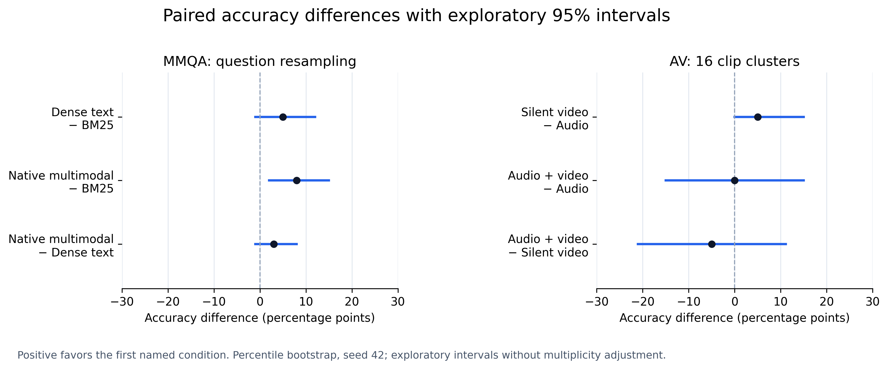

# Final local answer comparison

Generator: `google/gemma-4-E2B-it-qat-q4_0-gguf`. All values below were recomputed and checked against saved predictions and reports.

## MultiModalQA development pool

Questions: **100**. Same pooled corpus and k=5 across retrieval methods.

| Condition | Correct / N | Accuracy | Coverage | Invalid outputs | Gold citation precision | Gold citation recall |
|---|---:|---:|---:|---:|---:|---:|
| BM25 | 14 / 100 | 14.0% | 63.0% | 9 | 52.7% | 48.0% |
| Dense text | 19 / 100 | 19.0% | 79.0% | 8 | 64.9% | 57.0% |
| Native multimodal | 22 / 100 | 22.0% | 81.0% | 6 | 69.1% | 59.3% |

### Paired accuracy differences

Positive values favor the first named condition. Intervals are exploratory 95% percentile bootstrap intervals (10,000 resamples by default, seed 42).

| Comparison minus baseline | Difference (percentage points) | 95% interval (pp) | Resampling unit |
|---|---:|---:|---|
| Dense text − BM25 | +5.00 | [-1.00, +12.00] | question (100) |
| Native multimodal − BM25 | +8.00 | [+2.00, +15.00] | question (100) |
| Native multimodal − Dense text | +3.00 | [-1.00, +8.00] | question (100) |

### Gold-source modality groups

| Condition | Group | N | Accuracy | Coverage | Invalid outputs |
|---|---|---:|---:|---:|---:|
| BM25 | image | 18 | 5.6% | 38.9% | 2 |
| BM25 | image+table | 20 | 0.0% | 30.0% | 4 |
| BM25 | image+text | 4 | 0.0% | 25.0% | 1 |
| BM25 | table | 16 | 37.5% | 81.2% | 0 |
| BM25 | table+text | 14 | 0.0% | 64.3% | 1 |
| BM25 | text | 28 | 25.0% | 96.4% | 1 |
| Dense text | image | 18 | 0.0% | 61.1% | 5 |
| Dense text | image+table | 20 | 5.0% | 65.0% | 1 |
| Dense text | image+text | 4 | 0.0% | 75.0% | 0 |
| Dense text | table | 16 | 37.5% | 87.5% | 2 |
| Dense text | table+text | 14 | 14.3% | 85.7% | 0 |
| Dense text | text | 28 | 35.7% | 92.9% | 0 |
| Native multimodal | image | 18 | 16.7% | 66.7% | 3 |
| Native multimodal | image+table | 20 | 5.0% | 75.0% | 2 |
| Native multimodal | image+text | 4 | 0.0% | 50.0% | 1 |
| Native multimodal | table | 16 | 43.8% | 93.8% | 0 |
| Native multimodal | table+text | 14 | 7.1% | 78.6% | 0 |
| Native multimodal | text | 28 | 35.7% | 92.9% | 0 |

### Retrieval and answer error association

| Condition | All gold / correct | All gold / incorrect | Missing gold / correct | Missing gold / incorrect |
|---|---:|---:|---:|---:|
| BM25 | 14 | 36 | 0 | 50 |
| Dense text | 18 | 46 | 1 | 35 |
| Native multimodal | 22 | 49 | 0 | 29 |

These are associations, not causal diagnoses. Incorrect includes abstentions and invalid outputs; retrieving all annotated sources does not prove that the answer model understood them.

## Daily-Omni boundary-normalized subset

Questions: **20**. Unique clips: **16**.

| Condition | Correct / N | Accuracy | Coverage | Invalid outputs | Gold citation precision | Gold citation recall |
|---|---:|---:|---:|---:|---:|---:|
| Audio | 2 / 20 | 10.0% | 10.0% | 10 | Not annotated | Not annotated |
| Silent video | 3 / 20 | 15.0% | 45.0% | 4 | Not annotated | Not annotated |
| Audio + video | 2 / 20 | 10.0% | 60.0% | 5 | Not annotated | Not annotated |

Prespecified always-A baseline: **25.0%** (5/20). Uniform random choice has **25% expected accuracy**; this is an analytical expectation, not a measured random trial.

### Paired accuracy differences

Positive values favor the first named condition. Intervals are exploratory 95% percentile bootstrap intervals (10,000 resamples by default, seed 42).

| Comparison minus baseline | Difference (percentage points) | 95% interval (pp) | Resampling unit |
|---|---:|---:|---|
| Silent video − Audio | +5.00 | [+0.00, +15.00] | video_id cluster (16) |
| Audio + video − Audio | +0.00 | [-15.00, +15.00] | video_id cluster (16) |
| Audio + video − Silent video | -5.00 | [-21.05, +11.11] | video_id cluster (16) |

### Question categories

| Condition | Group | N | Accuracy | Coverage | Invalid outputs |
|---|---|---:|---:|---:|---:|
| Audio | AV Event Alignment | 1 | 0.0% | 0.0% | 0 |
| Audio | Comparative | 2 | 0.0% | 0.0% | 1 |
| Audio | Context understanding | 2 | 50.0% | 50.0% | 0 |
| Audio | Event Sequence | 7 | 0.0% | 0.0% | 4 |
| Audio | Inference | 5 | 20.0% | 20.0% | 2 |
| Audio | Reasoning | 3 | 0.0% | 0.0% | 3 |
| Silent video | AV Event Alignment | 1 | 0.0% | 0.0% | 0 |
| Silent video | Comparative | 2 | 0.0% | 0.0% | 0 |
| Silent video | Context understanding | 2 | 50.0% | 50.0% | 1 |
| Silent video | Event Sequence | 7 | 0.0% | 57.1% | 0 |
| Silent video | Inference | 5 | 40.0% | 60.0% | 2 |
| Silent video | Reasoning | 3 | 0.0% | 33.3% | 1 |
| Audio + video | AV Event Alignment | 1 | 0.0% | 100.0% | 0 |
| Audio + video | Comparative | 2 | 0.0% | 0.0% | 1 |
| Audio + video | Context understanding | 2 | 0.0% | 100.0% | 0 |
| Audio + video | Event Sequence | 7 | 0.0% | 57.1% | 2 |
| Audio + video | Inference | 5 | 40.0% | 80.0% | 1 |
| Audio + video | Reasoning | 3 | 0.0% | 33.3% | 1 |

## Interpretation limits

- MMQA uses the same 100-question development pool used during development, not an untouched test set or official leaderboard protocol.
- The AV experiment uses a duration-filtered, boundary-normalized subset; it is not an untouched full-clip benchmark.
- Invalid model responses and abstentions remain in the accuracy denominator. Transport/runtime failures abort evaluation and are not fabricated as answers.
- Citation gold overlap is not a measure of claim entailment or factual faithfulness.
- Intervals are exploratory paired percentile bootstrap intervals without multiplicity adjustment. MMQA questions may share supporting sources; AV resampling preserves video clusters.
- Retrieval-error associations are descriptive, not causal. Lexical exact match can penalize semantically equivalent wording.
- MMQA and AV use separately frozen configurations, differing at: generator_config, implementation. Each task retains its own generator configuration and implementation hashes; comparisons are only within each task.

